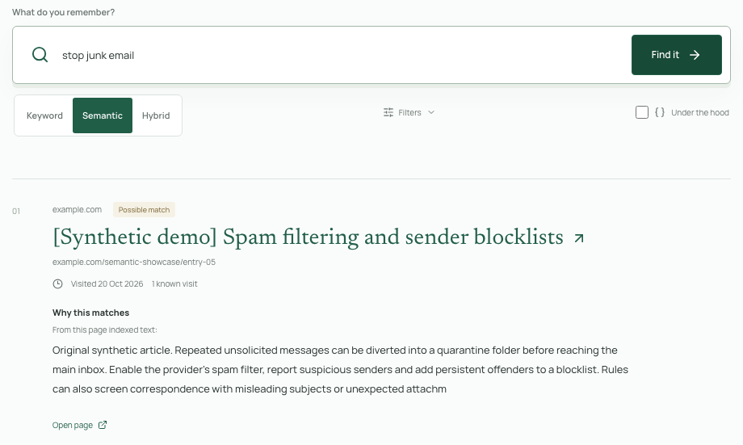
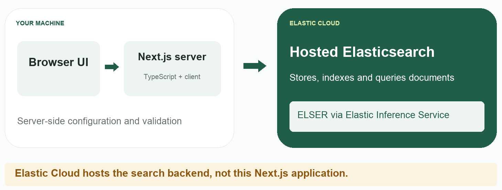
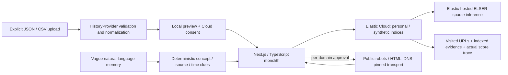
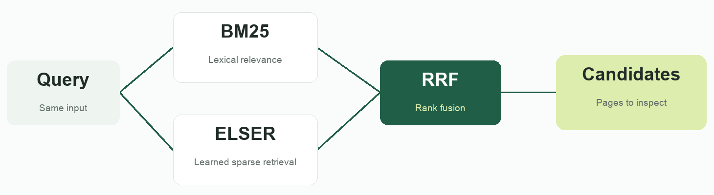

# I Saw It Somewhere

**Search the Internet you've already seen.**

You remember the idea, not the title: an AI agent operating a browser, a cloud outage
explanation, a Warsaw apartment with a huge balcony. Browser-history substring search asks
for precisely the words you forgot. This application searches your own imported trail using
meaning, words, source clues and remembered time.

Single-user, localhost MVP. Elasticsearch retrieves and ranks the pages. No chatbot, LLM
answer generator, internet crawler, social feed integration or fake local search backend.

This README is the technical companion to the short demo: what was built, where it runs,
how data is indexed and searched, and what you should know before trying it yourself.
The browser-history application is a concrete example of adding search to a TypeScript
application; comparing retrieval algorithms is not the project's underlying purpose.

> **Before you import anything:** the interface runs locally, but committed history and
> semantic inference use Elastic Cloud. Browser history can contain sensitive information.
> Start with the synthetic dataset. This is not a local-only history manager or a
> production-ready public service.

**Recorded verification, 2026-10-25:** source, offline tests, responsive browser contracts
and a Node 24 production build were verified. Live capability checks passed against
Elasticsearch **9.5.5** with
Elastic-hosted ELSER: indexing, hybrid RRF, explanations/highlights, repeat imports,
embedding preservation and historical filters. Relevance and latency targets remain
**unmeasured**. These are dated observations, not a claim that every deployment or future
release is validated. See [verification status](#verification-status).



This cropped image comes from a mocked UI-contract test with synthetic text. Fixture timing
has been omitted. It illustrates the interface, not live retrieval quality or performance.
[Earlier full desktop capture](docs/images/search-desktop.png) and
[mobile capture](docs/images/search-mobile.png) are also synthetic.

## Contents

- [From Video to Source](#from-video-to-source)
- [Deployment Overview](#deployment-overview)
- [Local Setup](#local-setup)
  - [Cloud console walkthrough](#prepare-the-cloud-backend)
- [Try Synthetic History](#try-synthetic-history)
- [Import Your History](#import-your-history)
- [Data Model and Indexing](#data-model-and-indexing)
- [Architecture](#architecture)
- [Retrieval Pipeline](#retrieval-pipeline)
- [REST API](#rest-api)
- [Why Elasticsearch?](#why-elasticsearch)
- [Why Not Just Ask an LLM?](#why-not-just-ask-an-llm)
- [Where Kibana, Logstash and Observability Fit](#where-kibana-logstash-and-observability-fit)
- [Optional Page Enrichment](#optional-page-enrichment)
- [Privacy, Security and Deletion](#privacy-security-and-deletion)
- [Testing and Evaluation](#testing-and-evaluation)
- [Verification Status](#verification-status)
- [Troubleshooting](#troubleshooting)
- [Frequently Asked Questions](#frequently-asked-questions)
- [Limitations and Roadmap](#limitations-and-roadmap)
- [Repository Guide](#repository-guide)
- [Publishing This Repository](#publishing-this-repository)
- [License](#license)
- [Official References](#official-references)

## From Video to Source

| Developer question | Start here | Implementation |
| --- | --- | --- |
| What does Elasticsearch do in this app? | [Deployment overview](#deployment-overview) and [retrieval](#retrieval-pipeline) | [Query builder](src/lib/search/query.ts) |
| Where is the application deployed? | [Local app versus cloud backend](#deployment-overview) | [Server connection](src/lib/elastic/client.ts) |
| How do I create and connect the Cloud backend? | [Hosted console walkthrough](#prepare-the-cloud-backend) | [Capability verification](scripts/preflight.ts) |
| Which endpoint and credentials do I need? | [Setup](#local-setup) and [API key scope](#api-key-scope) | [Configuration validation](src/lib/elastic/client.ts) |
| What becomes an Elasticsearch document? | [Data model](#data-model-and-indexing) | [Schema](src/lib/history/schema.ts), [mappings](src/lib/elastic/mappings.ts) |
| How are imports validated and merged? | [Import formats](#import-your-history) and [indexing](#data-model-and-indexing) | [Providers](src/lib/history/providers.ts), [merge](src/lib/history/merge.ts), [repository](src/lib/elastic/repository.ts) |
| Are Keyword, Semantic and Hybrid native capabilities? | [Three retrieval strategies](#retrieval-pipeline) | [Retrievers](src/lib/search/query.ts) |
| How do I call the application API? | [REST API](#rest-api) | [Route handler](src/app/api/%5B...segments%5D/route.ts) |
| What happens when inference is unavailable? | [Failure behavior](#retrieval-failures-and-fallback) | [Search service](src/lib/search/service.ts) |
| Is uploading real history private or risk-free? | [Privacy boundaries](#privacy-security-and-deletion) | [URL policy](src/lib/history/url.ts), [workflow state](src/lib/workflows.ts) |
| How do I reproduce or evaluate the demo? | [Synthetic history](#try-synthetic-history) and [testing](#testing-and-evaluation) | [Seed](scripts/seed.ts), [preflight](scripts/preflight.ts), [evaluation](scripts/evaluate.ts) |

## Deployment Overview

Elasticsearch is the search and analytics engine. It indexes JSON documents, executes
queries, applies filters and relevance scoring, and returns candidate pages. It is not
simply a place where this application stores data before ranking it somewhere else.



The diagram is an architectural illustration, not a screenshot of a provisioned deployment.
The deployment has three distinct parts:

| Part | Runs where | Responsibility |
| --- | --- | --- |
| Browser UI | Your local browser | Select files, approve operations, submit searches and inspect results |
| Next.js / TypeScript server | One local Node process | Validate inputs, hold temporary previews, enforce workflow rules and call Elasticsearch |
| Elasticsearch | Your Elastic Cloud Hosted deployment | Persist page documents and execute lexical, semantic and hybrid retrieval |
| ELSER inference | Elastic Inference Service (EIS) | Generate sparse representations for semantic indexing and query-time retrieval |

**Elastic Cloud hosts the search backend, not this Next.js application.** The server
connects to Elasticsearch over HTTPS. The browser does not receive the Elasticsearch API
key and does not connect directly to the deployment.

EIS is a separate inference service. Its processing location is not necessarily the exact
region of the Elasticsearch deployment. Review current routing, region policies and terms;
do not infer data residency from the deployment's region label alone.

### The end-to-end flow

1. Select an export, or load synthetic history into a local preview.
2. Validate and normalize records without indexing them.
3. Explicitly approve cloud processing.
4. Group records by normalized page URL and write documents through the Bulk API.
5. Elasticsearch generates the semantic representations for the configured field.
6. Submit a query with a dataset, retrieval mode and optional filters.
7. Elasticsearch retrieves and ranks candidates; the app displays up to ten safe results
   with indexed evidence.

Optional page fetching is a separate, explicitly approved workflow. Importing history
does not automatically download every visited webpage.

### Technology choices

| Area | Used here |
| --- | --- |
| UI and server | Next.js 16.4.2 App Router, React 19.3.0, TypeScript |
| Runtime | Node 24 LTS; Node route handlers, not an Edge runtime |
| Elasticsearch connection | Official `@elastic/elasticsearch` JavaScript client, pinned to 9.2.0 |
| Input validation | Zod and `csv-parse` |
| Public-page extraction | Mozilla Readability, jsdom, `robots-parser`, Undici and IP-address validation |
| Tests | Vitest and Playwright |
| Persistent history storage | Elasticsearch only |

Installed dependency versions are pinned in [package.json](package.json) and
[package-lock.json](package-lock.json). These are the project's versions, not a statement
that newer releases are unsupported by the underlying products.

## Local Setup

Prerequisites: Node **24 LTS**, npm, and **Elastic Cloud Hosted Elasticsearch 9.x, version
9.2 or later**, with
Elastic-hosted ELSER inference and native RRF available under your subscription. This targets
one documented capability profile, not every Elastic offering. Cloud storage/inference may
cost money; the app does not provision or purchase services.

### Prepare the cloud backend

The walkthrough below uses **manual Hosted provisioning, followed by connecting the local
application**. There is no step that uploads the Next.js application to Elastic Cloud.
The app creates its history indices later, when data is indexed.

The recorded live verification used Elasticsearch **9.5.5** with `.elser-2-elastic` on
2026-10-25. The public verification record does not establish a particular cloud provider,
region, hardware profile or node count, so this guide does not invent those choices.
The steps below explain how to reproduce the supported configuration.

#### Create a Hosted deployment

1. Sign in to the Elastic Cloud console and enter the **Hosted deployments** workflow.
   Choose **Create deployment**, not a Serverless project creation flow.
2. Select the Elasticsearch/Search solution view for this walkthrough. A solution view
   changes the initial navigation/features you see; it does not deploy this repository's
   frontend or instrument its requests for observability.
3. Review the deployment settings before creating the resource:

   | Choice | What matters for this project |
   | --- | --- |
   | Cloud provider | Hosted supports AWS, Google Cloud and Azure. This app does not require one particular provider or your own provider API keys. |
   | Region | Choose according to latency, data-handling requirements and availability; separately review EIS processing locations. |
   | Elastic Stack version | Use compatible Elasticsearch 9.x, minor version 2 or later. The recorded verified version is 9.5.5, not a promise that every newer release is tested. |
   | Hardware profile, capacity and zones | Review workload needs, estimated charges and availability requirements. This repository does not establish a measured minimum RAM/node count or a production sizing recommendation. |
   | Autoscaling and limits | Inspect the controls available for your account and their cost implications; do not enable or increase capacity just to match an illustration. |
   | Deployment name | Use a recognizable development name without confidential information if it might appear in public captures. |

4. Confirm the price/terms and select **Create deployment**. Some advanced settings are
   exposed differently for a first trial deployment; use the current console and
   [official Hosted creation guide](https://www.elastic.co/docs/deploy-manage/deploy/elastic-cloud/create-an-elastic-cloud-hosted-deployment)
   rather than expecting identical controls in every account.
5. If initial administrator credentials are shown, store them securely. They may be
   displayed only once. **Do not screenshot, commit or use that bootstrap password as
   the application's configuration.** This app authenticates with an Elasticsearch API key.
6. Wait for the deployment to become ready, then open its overview and Kibana. A ready
   deployment is not yet proof that the required inference and RRF path works.

#### Obtain the endpoint and a scoped application key

1. On the deployment overview, find the Elasticsearch application/connection details and
   use **Copy endpoint**. Menu placement can vary by console version.
2. Keep the **Elasticsearch HTTPS endpoint**, not the Kibana URL, a Cloud management API
   URL, Cloud ID or browser address of the console. The JavaScript client uses this value
   as its `node` URL.
3. In Kibana's API-key management interface, or using the Elasticsearch security API,
   create an expiring Elasticsearch key with the [required scope](#api-key-scope).
   Avoid an unrestricted administrator key as the app's long-lived credential.
4. Put the key's **encoded value**, not just its ID or a Cloud organization-management
   key, in local server configuration. It must not be a `NEXT_PUBLIC_` value.

The AWS-shaped endpoint in the template below is only a placeholder. Use the actual
endpoint for your own provider/region; the example does not document the author's provider.

#### Confirm the inference endpoint

Open Kibana's inference-endpoint management interface; use its navigation search if menu
labels differ across versions. Check the endpoint that this app explicitly expects:

| Property | Expected by this project's preflight |
| --- | --- |
| Inference endpoint ID | `.elser-2-elastic` |
| Service | `elastic` |
| Task type | `sparse_embedding` |
| Intended model path | Elastic-hosted ELSER through EIS |

Confirm endpoint availability, authorization, subscription and region policies. The app
does not create inference endpoints or change your plan.

This is the **ELSER-on-EIS** path, not a tutorial for downloading `.elser_model_2` and
deploying it on the cluster's own ML nodes. A different model/deployment path is not a
drop-in replacement for this V1 configuration. See
[explicit semantic inference configuration](https://www.elastic.co/docs/reference/elasticsearch/mapping-reference/semantic-text-setup-configuration).

Continue with local installation/configuration and then the consented capability check
below. There are two separate milestones: **the deployment exists**, and **the application
can index and retrieve data using its required capabilities**.

No automatic provisioning, model deployment, subscription change or capacity purchase is
performed by this app.

### Install and configure

Clone or download this repository. If you use nvm, `.nvmrc` selects Node 24; otherwise
install that runtime using your usual Node version manager. Then:

```sh
nvm use
npm ci
cp .env.example .env.local
```

Configure the local environment with your deployment's HTTPS Elasticsearch endpoint and an
Elasticsearch API key (encoded value, not a Cloud organization-management key):

```dotenv
ELASTICSEARCH_URL=https://your-deployment.es.your-region.aws.elastic.cloud:443
ELASTICSEARCH_API_KEY=
ELASTICSEARCH_INFERENCE_ID=.elser-2-elastic
ELASTICSEARCH_INDEX_PREFIX=isis
NEXT_TELEMETRY_DISABLED=1
```

The values above are placeholders. Put real values only in your local, ignored configuration.

| Variable | Required | Meaning |
| --- | --- | --- |
| `ELASTICSEARCH_URL` | For indexing/search | HTTPS Elasticsearch endpoint, without embedded credentials, query string or fragment |
| `ELASTICSEARCH_API_KEY` | For indexing/search | Encoded Elasticsearch API key; not a Cloud organization-management key |
| `ELASTICSEARCH_INFERENCE_ID` | Defaults to `.elser-2-elastic` | V1 explicitly requires this endpoint; it is not an unrestricted model selector |
| `ELASTICSEARCH_INDEX_PREFIX` | Defaults to `isis` | Lowercase letter followed by up to 40 lowercase letters, digits or hyphens; changes the app's index namespace |
| `NEXT_TELEMETRY_DISABLED` | Recommended | Disables Next.js telemetry; it does not disable required Elastic Cloud processing |

Never commit real credentials or expose them through `NEXT_PUBLIC_`. The explicit endpoint
pins **Elastic-hosted sparse ELSER**, rather than a default model that can change on upgrade.
In Kibana, check endpoint availability, subscription, costs and inference processing location.
Creating a `semantic_text` mapping alone does not prove inference/RRF are functional.

The server validates configuration before creating a cached official client, with no
automatic client retries and a default 10-second request timeout. Bulk writes use a longer
55-second request timeout. See [the actual connection code](src/lib/elastic/client.ts)
and [repository](src/lib/elastic/repository.ts), rather than copying secrets into a
frontend component.

### Verify capabilities, then start

Run the intentional, billable **synthetic-only** capability check, then start the app:

```sh
npm run preflight -- --consent
npm run dev
```

Preflight creates temporary synthetic probe indices, exercises real inference/retrieval,
and attempts cleanup in a `finally` block. It **does not seed the normal demo dataset**.
After it passes, use [Load sample history or the seed command](#try-synthetic-history).
Do not grant extra privileges blindly just to make a probe pass.

Open **http://127.0.0.1:3000**. Another port: `npm run dev -- --port 3001`.
Keep one consistent origin; the API rejects cross-origin writes. Restart after changing
environment configuration. Without credentials the UI/local previews work, but indexing and
real search report missing setup instead of inventing results. There is no offline search
engine, including for Keyword mode.

`GET /api/health` reports whether configuration values are present and valid. It does not
contact Elasticsearch or certify permissions, model availability, subscription or relevance.
Use the explicit capability check for that first group of external dependencies.

Local production: `npm run build` then `npm start`. **Do not expose the server publicly**:
there is intentionally no authentication, multi-user isolation or multi-process coordination.

Closing the browser or stopping the local Node server does **not** shut down the Hosted
deployment or end its resource charges. Deleting application indices is also different
from deleting the deployment. Review unused resources deliberately in the Cloud console,
preserving any data/backups you still need; this app does not manage that infrastructure
lifecycle for you.

### API Key Scope

Use a dedicated expiring key, not a superuser password. Runtime index permissions are scoped
to these exact aliases and backing indices (adjust names for a different prefix):

```text
isis-demo-v1          isis-demo-v1-data
isis-personal-v1      isis-personal-v1-data
```

Index-level `read`, `write`, `create_index` and `manage` cover the app's lifecycle; `manage`
is necessary for create-with-alias, mappings and deletion. Do not grant cluster-level `all`
or unrestricted index access. Permit use of the configured inference endpoint as required
by your deployment. Validate privileges against the actual release, not a guessed role.

Prefer a separate setup/evaluation key: preflight needs cluster version/endpoint inspection
(`monitor`, `monitor_inference`) and lifecycle access to `isis-check-*`; evaluation needs
`isis-eval-*`, not personal data. Endpoint setup is an operator task that can require
`manage_inference`; the app does not create models/endpoints. [Official privileges](https://www.elastic.co/docs/reference/elasticsearch/security-privileges).

| Workflow | Scope to consider |
| --- | --- |
| App runtime and lifecycle | The four exact app alias/backing-index names above, plus required use of the configured inference capability |
| Synthetic preflight | Version/inference inspection and lifecycle access to the random `isis-check-*` namespace |
| Retrieval evaluation | Lifecycle/search access to the isolated `isis-eval-*` namespace and required inference use |
| Deployment/model administration | Separate operator privileges; not unrestricted privileges embedded in the running app |

This is scope guidance, not a universally validated role descriptor for every release and
subscription. Check the actual Elasticsearch authorization requirements for your deployment.
In particular, this MVP lets the application create and delete its own indices: a runtime
key with those permissions can also destroy data within its scope. A production design
would normally separate setup, ingestion, search and destructive administration.

If you change the index prefix, update the key's allowed names too. The app does not
automatically migrate old data or broaden key privileges.

## Try Synthetic History

Select **Load sample history**, inspect the local preview, acknowledge Cloud/EIS processing,
then **Index history**. Demo history contains **65 pages / 106 known visits**: the original
60-page corpus across browser agents, local Mac models, outages, hybrid search, apartments
and distractors, plus five full-text semantic showcase pages. The separate evaluation
corpus remains at 60 pages / 101 visits.
Dates are relative to loading time. Public-looking URLs are illustrative: text/visits are
synthetic, not anyone's private history. No visited website is fetched while seeding.

Alternative intentional seed command:

```sh
npm run seed -- --consent
```

### Confirm that the normal demo was indexed

After seeding, select **Demo history** in the app and submit a search. You can also inspect
the default demo alias/backing index in Kibana's index management interface.

For read-only inspection in **Kibana Dev Tools**, not the local application's REST API:

```text
GET isis-demo-v1/_count
GET isis-demo-v1/_mapping
```

Replace `isis` if you configured another prefix. A fresh, otherwise unmodified normal demo
contains 65 page documents; `_count` counts documents, not visit timestamps. The first
normal seed supplies 106 known visits. Relative-date reloading can add visit timestamps
without adding page URLs, so do not delete data just to reproduce a reference visit count.

The mapping should show the semantic field and explicit inference ID. Neither an index
count nor its mapping alone establishes successful semantic search: the capability probe
and actual retrieval exercise that behavior. If only preflight was run, its temporary
probe indices should be cleaned up and the normal demo can still be empty.

Reloading merges newly generated relative demo visits; personal history is untouched.
An identical history file, including identical visit timestamps, reimports as a no-op.

Demo queries:

- `noisy upstairs neighbors`
- `burnt pan cleaning`
- `forgot my password`
- `water plants on vacation`
- `stop junk email`

These five examples also appear on the Demo start screen. Clicking one fills the query
without searching or changing the selected mode; submit explicitly to compare retrieval.

### Synthetic Semantic Showcase

Five original full-text articles, included in normal Demo loading, illustrate a vocabulary gap between
an indexed page and a natural paraphrase. These are **constructed teaching examples**, not
real browser visits, a representative benchmark or evidence that personal-history searches
will achieve the same results. Their titles begin with `[Synthetic demo]`, and their URLs
are illustrative placeholders rather than real article destinations.

Seed only these five pages into **Demo history**, without deleting existing demo pages or
touching personal history. This transmits synthetic text to Cloud/EIS and may incur charges:

```sh
npm run seed -- --semantic-showcase --consent
```

Select **Demo history**, clear domain/date filters, and submit the same query in each mode.
Measured on the configured Elasticsearch 9.5.5 deployment on 2026-10-25:

| Query | Intended Synthetic Page | Keyword Target Rank | Semantic Target Rank | Hybrid Target Rank |
| --- | --- | --- | --- | --- |
| `noisy upstairs neighbors` | Acoustic isolation for residential ceilings | Not returned | 1 | 1 |
| `burnt pan cleaning` | Restoring scorched stainless cookware | Not returned | 1 | 1 |
| `forgot my password` | Recovering sign-in credentials | Not returned | 1 | 1 |
| `water plants on vacation` | Reservoir irrigation for indoor greenery | Not returned | 1 | 3 |
| `stop junk email` | Spam filtering and sender blocklists | Not returned | 1 | 1 |

Ranks refer to the intended page among the app's ten displayed results. Keyword returned
two other pages for the plant-care query and no results for the other four. Hybrid's lower
plant-care rank is a useful illustration that fusion is not guaranteed to beat Semantic.
These measurements can change as the demo index or inference service changes.

The [showcase fixture](fixtures/semantic-showcase.json) keeps each test query as metadata;
the seed helper explicitly excludes it from indexed text. Retrieval/scoring is unchanged,
and the original 60-page evaluation corpus and declared holdout queries are untouched.
Returned candidates use the neutral heading `Possible matches.` regardless of word overlap;
empty retrieval uses `No matches this time.` The legacy API uncertainty status remains
compatible but is not presented as a confidence judgment. These ranks are observations,
not confidence scores.

## Import Your History

Choose **Import history** and a JSON history export or UTF-8 CSV. Limits: 50 MiB / 100,000 rows.
No private file is needed to build or test. Use canonical field names:

```json
[
	{
		"url": "https://example.com/page",
		"title": "A page I remember",
		"visited_at": "2026-10-25T10:30:00.123Z",
		"visit_count": 3,
		"description": "Optional description",
		"page_content": "Optional plain searchable text"
	}
]
```

Required: `url`, `title`, `visited_at`. Optional: `visit_count`, `domain`, `description`,
`page_content`. Domain is derived from URL; supplied domain must agree. Canonical `visited_at`
needs a timezone, not a numeric browser epoch or locale date. CSV supports quoted multiline text; malformed
structure/duplicate headers fail. [JSON fixture](fixtures/history.json), [CSV fixture](fixtures/history.csv),
[complete validation/merge contract](specs/data-model.md).

| Input | Current limit or contract |
| --- | --- |
| File | UTF-8 JSON/CSV, at most 50 MiB; multipart framing has a separate bounded allowance |
| Records | 1 to 100,000 rows |
| URL | 1 to 8,192 characters, absolute HTTP/HTTPS, subject to URL safety checks |
| Title | Required, nonblank, at most 2,000 characters |
| Description | Optional, at most 10,000 characters |
| Page content | Optional plain text, at most 100,000 characters |
| Visit timestamp | Valid RFC3339 with a timezone and at most millisecond precision |
| Reported visit count | Optional positive safe integer |
| Known visits per page | At most 10,000 distinct timestamps after merging |

Input `visited_at` is **one visit timestamp per row**. The stored page document has an
array of known timestamps after rows are merged. Do not confuse an export record with
the complete stored-document schema.

Safari's `{ "metadata": {...}, "history": [...] }` exports and Google Takeout's
`{ "Browser History": [...] }` are also accepted. Named `history`, `records`, `items`,
`visits`, and `data` wrappers are recognized, including one envelope level under `data`.
Browser `time_usec` is converted from Unix microseconds, extension `lastVisitTime` from
Unix milliseconds, and `visitCount` to `visit_count`; units are not guessed. Export and
redirect timestamps do not become visits. Rows without titles appear in validation errors
and can be explicitly skipped using valid-only import; the app does not invent page titles.

Preview happens in localhost RAM, with safe row/field errors. Mixed files require valid-only
acknowledgment. Indexing separately requires Cloud consent. Fetching needs a second approval.
Selecting a file is not the same as committing it to Elastic Cloud. The application does
not copy the original upload into a persistent local history database.

One normalized URL becomes one page with all distinct known timestamps. Tracking parameters
and ordinary anchors are removed; meaningful query order, path case/trailing slash, hash
routes and HTTP/HTTPS stay distinct. Browser aggregate counts are merged by **max**, never
added across exports. A reported count is not a fabricated list of observed visits.

Normalization removes `utm_*`, `fbclid` and `gclid`; it does not remove every query parameter.
Recognizable credential-bearing parameters are rejected, but ordinary URLs and their values
can still be personal or confidential. Normalization is not redaction or anonymization.
Private-address checks for imports and stricter fetching rules have different purposes;
an imported URL being accepted does not automatically make it eligible to fetch.

Imports are **batched, not atomic**. A cancelled operation or process restart can leave
successfully committed pages in Cloud while the remaining preview is lost. Recreate the
preview to continue; an identical reimport merges rather than duplicating known visits.
One active preview is supported per server process, so creating a new preview can invalidate
an older browser tab's ticket.

### What if the export contains only URLs and titles?

Those are all the search system can initially use. ELSER does not visit the URL or invent
the page's full text. Supply optional description/content in the export or use approved
public-page enrichment. Private, dynamic, paywalled or unavailable pages may never acquire
full text; the app must still preserve the original history record.

## Data Model and Indexing

### Aliases, backing indices and datasets

For the default prefix, the repository creates:

| Dataset | Alias used by application operations | Backing index |
| --- | --- | --- |
| Synthetic demo | `isis-demo-v1` | `isis-demo-v1-data` |
| Personal history | `isis-personal-v1` | `isis-personal-v1-data` |

The alias is created with `is_write_index: true`. Bulk operations require an alias, which
helps prevent a late write from silently creating an unintended index after deletion.
The repository expects one backing mapping with schema version 1 and the configured
inference ID. An incompatible mapping produces `mapping_mismatch`, not a silent migration.

These are two datasets for one local user, **not two authenticated tenants**.
The app does not configure a rolling data stream or an index lifecycle policy.

### A page document

The document identity is SHA-256 of the normalized URL. This is stable page identity,
not anonymization: the original normalized URL is also stored.

Illustrative stored-document excerpt, with text abbreviated and additional fields omitted:

```json
{
  "url": "https://example.com/semantic-showcase/entry-05",
  "domain": "example.com",
  "title": "[Synthetic demo] Spam filtering and sender blocklists",
  "visited_at": ["2026-10-20T13:00:00.000Z"],
  "description": "A practical guide to sorting unsolicited correspondence.",
  "content": "Original synthetic article about unsolicited messages...",
  "semantic_text": "Title: ...\nDescription: ...\nContent: ..."
}
```

The complete [PageDocument contract](src/lib/history/schema.ts) also records first/last
visits, reported-count maxima, provenance, content hash, fetch status and timestamps.
`knownVisits` counts actual distinct timestamps; `visit_count` can reflect a larger
browser-reported aggregate. Missing visits are never fabricated to fill that gap.

### Mappings and semantic input

This excerpt explains the principal field choices; it is **not the full mapping to create
manually**. The repository creates a stricter mapping with additional fields and `_meta`.

```json
{
  "properties": {
    "title": { "type": "text", "analyzer": "english" },
    "domain": { "type": "keyword" },
    "visited_at": { "type": "date", "format": "strict_date_optional_time" },
    "semantic_text": {
      "type": "semantic_text",
      "inference_id": ".elser-2-elastic"
    }
  }
}
```

- Text fields support analyzed, word-based retrieval. Domain is an exact-value field.
- Elasticsearch date arrays allow a range query to match any known visit.
- [Semantic input](src/lib/history/merge.ts) combines **title, description and content**.
  URL text participates in lexical search but is not explicitly appended to that semantic input.
- The `semantic_text` field delegates sparse representation generation to ELSER on EIS.
  This implementation is not a dense-vector/kNN pipeline.
- `dynamic: "strict"` makes unexpected stored fields an error rather than silently adding
  arbitrary new mappings.

### Bulk writes, retries and embedding preservation

[HistoryRepository](src/lib/elastic/repository.ts) reads existing documents, merges a
batch, then issues Bulk `create` or partial `update` operations. It checks every item
outcome; a successful HTTP response alone is not enough to mark every document persisted.

Updates use sequence number/primary term concurrency checks. Conflicts can be re-read
and retried up to two times. An identical document is counted as unchanged.

A content hash covers the semantic input. When only visit/fetch metadata changes, the
Bulk patch omits `semantic_text` so existing representations can be reused. Changed
title/description/content includes it again and can invoke inference. This follows
[Elastic's documented Bulk partial-update behavior](https://www.elastic.co/docs/reference/elasticsearch/mapping-reference/semantic-text-ingestions);
do not assume full replacements or every Update API path have the same inference cost.

Indexing can incur semantic inference costs **even if you later search in Keyword mode**:
query-mode selection does not change the document-ingestion mapping.

## Architecture



Elasticsearch is the only persistent history store. Previews/approvals and robots/rate caches
are bounded in-memory state. No extra database, queue, worker or browser history cache.
One Node process only; restart loses previews/consent. Import <=25 pages/request; enrichment
<=5 URLs/request. HistoryProvider separates JSON/CSV from indexing and future extension capture.

Entry points: [providers](src/lib/history/providers.ts), [repository](src/lib/elastic/repository.ts),
[retrieval DSL](src/lib/search/query.ts), [evidence](src/lib/search/evidence.ts),
[secure transport](src/lib/enrichment/transport.ts), [coordination](src/lib/workflows.ts),
[API](src/app/api/%5B...segments%5D/route.ts). Detailed contracts are linked in the
[repository guide](#repository-guide).

Import previews expire after ten idle minutes, but valid commit batches renew that idle
timeout before and after work. Enrichment approvals have a fixed ten-minute expiry instead.
Neither is a durable job. Restarting the process loses previews, approvals and caches,
but does not delete already indexed Cloud data.

## Retrieval Pipeline



These are official Elasticsearch search approaches, exposed as an application-level
selector. The labels are not a special three-mode switch in the JavaScript client:

| UI label | API mode | Native implementation | Useful when |
| --- | --- | --- | --- |
| Keyword | `lexical` | BM25 with `multi_match` | You remember actual terminology, a title fragment or URL text |
| Semantic | `semantic` | `match` against ELSER-backed `semantic_text` | You remember the idea using different words |
| Hybrid | `hybrid` | Both standard retrievers combined with RRF | Both lexical and conceptual signals may help |

The same indexed pages support all three. No separate database or application is created
for each mode. They also are not the only kinds of queries Elasticsearch supports.

The search bar includes a **Keyword / Semantic / Hybrid** selector. Hybrid is the default;
Keyword executes BM25 only, Semantic executes ELSER only, and Hybrid combines both using
native RRF. Select a mode, then press **Find it** or Enter. Changing mode preserves your
query, selected history and filters, clears old results, and does not submit automatically.
The result heading reports the actual executed mode. Explicit Keyword mode is not a
semantic outage; a Hybrid fallback still displays a warning and reports Keyword results.

For a fair demo, keep the same query, dataset and filters while switching modes. Compare
the intended page's rank and the relevance/evidence of the top results, not raw cross-mode
scores. **Under the hood** shows the actual retriever stages, timings and query. Semantic
and Hybrid searches use Elastic inference and may incur usage costs; selecting a button
alone makes no search request. This selector is separate from Demo history / My history.

1. Deterministically parse supported English concept/source/time clues without an LLM.
2. BM25 over `title^4`, `description^2`, `content`, `url_search` finds lexical memories.
3. `match` on `semantic_text` invokes the pinned ELSER endpoint for sparse semantic retrieval.
4. Both Elasticsearch content queries multiply by 1.25 for the inferred source and 1.15
	 for any visit in the approximate time window. Hints are soft, not exclusion rules.
5. Explicit UI domain/date filters constrain both child retrievers.
6. Elasticsearch native reciprocal rank fusion combines the lists (constant 60, window 100).
7. Return <=10 pages in Elasticsearch order, quoting actual indexed passages/metadata.

Date arrays let a July visit match even after an October revisit. No generic recency or
popularity boost overrides the remembered concept. [Exact time grammar](specs/search.md).

Results remain **Possible match** until live calibration justifies stronger language. Weak,
empty and unavailable states are distinct. No percentages, generated answers or outside-index
URLs. A Hybrid inference outage can trigger an explicitly labeled keyword-only retry;
explicit Semantic mode never silently substitutes another mode. Configuration and
authentication/authorization failures are surfaced; the current search-404 behavior is
documented below. No client-side reranking or incompatible raw-score sum.

### The query building blocks

Simplified content-query fragments below omit the shared filters, `function_score` wrapper
and response configuration. They are explanatory excerpts, not complete REST search bodies.
The full request is built in [query.ts](src/lib/search/query.ts).

Lexical content query:

```json
{
  "multi_match": {
    "query": "stop junk email",
    "fields": ["title^4", "description^2", "content", "url_search"],
    "type": "best_fields"
  }
}
```

BM25 is the default relevance scoring behind these full-text fields. Title and description
boosts prioritize those fields; they are not probabilities. This UI's "Keyword" means
**lexical full-text search**, not literal substring matching or a query only over
Elasticsearch `keyword`-typed fields.

Semantic content query:

```json
{
  "match": {
    "semantic_text": {
      "query": "stop junk email"
    }
  }
}
```

The field mapping makes this inference-backed retrieval despite the `match` syntax.
ELSER generates a learned sparse representation, not an answer or a summary. It searches
the information actually indexed; it does not acquire unseen page text.

Hybrid composition excerpt:

```ts
const hybridRetriever = {
  rrf: {
    retrievers: [lexical, semantic],
    rank_constant: 60,
    rank_window_size: 100
  }
};
```

Here `lexical` and `semantic` are the complete standard retrievers constructed by the
application. Elasticsearch executes the retrieval branches and fuses their rankings
within one search request; the browser does not concatenate two result lists.

Conceptually, a document receives a contribution `1 / (60 + rank)` from each branch where
it appears, using that branch's one-based rank. A requested fusion window of 100 is
different from the maximum 30 returned Elasticsearch hits and ten displayed application
results. A small RRF score is not evidence of low confidence.

### Remembered clues versus explicit filters

For example, `I saw an AI agent that controls a browser, probably GitHub a few months ago`
can produce:

- Concept: `an AI agent that controls a browser`.
- Source hint: `github.com`.
- Approximate time hint: 180 to 60 days before the query's UTC reference time.

Recognized hints are extracted locally by a small deterministic parser, not by an LLM.
Conflicting hints produce warnings and no corresponding inferred boost. An input containing
only source/date scaffolding is rejected with `subject_required` rather than becoming
`match_all`. This is a deliberately bounded English grammar, not arbitrary date understanding.

Inferred source/time hints are **soft boosts**. The explicit domain/start/end controls are
**hard filters**. Metadata adjusts each content retriever's ranking before fusion; it is
not a third independent RRF retriever or an invented additive final score.

### Retrieval failures and fallback

| Situation | Current behavior |
| --- | --- |
| Explicit Keyword search | Executes lexical retrieval without describing it as an outage |
| Explicit Semantic search fails | Surfaces an error; never pretends that Keyword results were semantic |
| Hybrid encounters a supported availability/inference failure | Tries lexical retrieval once within the same overall deadline, with a warning and actual response mode `lexical` |
| Elasticsearch reports timeout or failed shards | Rejects an incomplete search |
| Search returns HTTP 404, such as a missing app index | Returns `no_matches`; run preflight and seed/check the selected dataset before treating this as evidence about relevance |
| Configuration/authentication/authorization failure | Reports setup/access/service failure, rather than fabricating local results |

The Hybrid fallback covers selected 429/502/503/504 responses and specific inference/model
errors on 400/500. It is not a catch-all retry for every exception. Elasticsearch requests
use an 8-second search timeout and the service shares a 10-second abort deadline across the
initial attempt and any fallback. API admission allows at most two concurrent searches
per Node process.

### Evidence and developer diagnostics

**Under the hood** displays actual clues, DSL, stages, counts, timings and RRF explanations.
Raw content/adjusted scores, ranks and fusion contributions appear only when available;
unknown shapes return null plus the original explanation. Metadata changes child rankings,
not a fictional additive final score. Explain currently runs for bounded hits even with the
panel hidden; its live cost remains unmeasured.

The legacy API status `no_confident_matches` reflects insufficient lexical overlap, not
calibrated semantic confidence. The UI deliberately uses neutral headings for returned
candidates. A relevant semantic result is not discarded merely because the query and
excerpt lack shared words.

`latencyMs` measures the server-side search service; `elasticTook` is Elasticsearch's
reported execution time. Neither alone is browser end-to-end latency. Debug output can
contain your query and indexed text: use synthetic data when recording or sharing it.

## REST API

The browser calls local Next.js route handlers, not Elasticsearch directly. The server
validates inputs with Zod, enforces local request boundaries and uses `Cache-Control:
no-store`. The [route implementation](src/app/api/%5B...segments%5D/route.ts) is authoritative;
the [full API contract](specs/api.md) includes detailed response fields.

### Endpoint reference

| Method and path | Request or purpose | Cloud/site activity |
| --- | --- | --- |
| `GET /api/health` | Configuration/profile summary | No live capability probe |
| `POST /api/imports/preview` | JSON `{ "sample": true }`, or multipart file with `dataset=personal` | Local parsing only |
| `POST /api/imports/:id/commit` | `{ "cloudConsent": true, "validOnly": true, "cursor": 0 }` | Cloud indexing/inference, up to 25 grouped pages |
| `DELETE /api/imports/:id` | Discard current preview | Does not undo committed pages |
| `POST /api/search` | Query, dataset, mode, filters and optional debug | Cloud search; semantic modes use inference |
| `GET /api/history/stats` | Per-dataset page/visit/fetch counts | Reads Elasticsearch aggregations |
| `POST /api/enrichment/preview` | `{ "dataset": "personal", "pageIds": [...] }`, 1-100 IDs | Reads existing indexed pages; no website contact |
| `POST /api/enrichment/:ticket/run` | Approved exact hostnames and cursor | Approved website requests plus Cloud updates/inference as content changes |
| `DELETE /api/history` | `{ "confirmation": "DELETE ALL HISTORY" }` | Destructively deletes both app datasets under the configured prefix |

File uploads belong to the personal dataset even if the file itself is synthetic. The
JSON sample-preview route and seed script create the demo dataset. A preview, an enrichment
ticket and a page ID are different identifiers; do not substitute URLs for ticket-bound IDs.

### Calling the local API

All non-GET requests, including search and preview, require an `Origin` matching the
actual local host/port. CLI tools must supply it too. There is no CORS interface for an
unrelated website. These checks are not user authentication and do not make a public
deployment safe.

Configuration-only check:

```sh
curl --fail-with-body --silent --show-error \
  http://127.0.0.1:3000/api/health
```

Create a synthetic preview without indexing it:

```sh
curl --fail-with-body --silent --show-error \
  -H 'Origin: http://127.0.0.1:3000' \
  -H 'Content-Type: application/json' \
  --data '{"sample":true}' \
  http://127.0.0.1:3000/api/imports/preview
```

For programmatic indexing, read the returned `previewId`, then call its commit endpoint
with explicit cloud consent, `validOnly` and the current cursor. Start at zero and use the
returned `nextCursor` until `complete` is true; inspect `failed` and `errors` rather than
assuming every HTTP 200 indexed every page. Mixed-validity files require `validOnly: true`.
One call is not a whole-import transaction.

After loading sample history, search it:

```sh
curl --fail-with-body --silent --show-error \
  -H 'Origin: http://127.0.0.1:3000' \
  -H 'Content-Type: application/json' \
  --data '{"query":"stop junk email","dataset":"demo","mode":"hybrid","debug":true}' \
  http://127.0.0.1:3000/api/search
```

Change `mode` to `lexical` or `semantic` to compare. Query-mode omission defaults to Hybrid.
The response's mode is the **executed** mode, which can differ after a warned fallback.
No Elasticsearch API key belongs in these local curl commands.

Search input with explicit constraints, using example dates that should be adjusted to
the dates actually present in your dataset:

```json
{
  "query": "stop junk email",
  "dataset": "demo",
  "mode": "semantic",
  "debug": false,
  "filters": {
    "domain": "example.com",
    "start": "2026-10-01T00:00:00Z",
    "end": "2026-11-01T00:00:00Z"
  }
}
```

The query must have 3-1,000 characters and a meaningful subject after clue extraction.
Filters accept one exact lowercase hostname and RFC3339 timestamps with timezone.
Start is inclusive, end is exclusive, and start must precede end. No result pagination
is implemented.

### Responses and errors

Search responses include `mode`, `status`, `clues`, `results`, `warnings`, `latencyMs` and
`elasticTook`; `trace` is present only for debug requests. Results expose page metadata,
visit information and selected evidence, not embeddings or a full stored-document dump.

Errors use `{ "error": { "code": "...", "message": "...", "requestId": "...", "issues": [] } }`,
with `issues` optional. Rejected private values and raw Elasticsearch errors are not
included in the normal error response. Relevant HTTP categories are:

| Status | Typical meaning |
| --- | --- |
| 400 | Wrong content type, malformed JSON or request format |
| 403 | Local Host/Origin violation |
| 404 | Unknown application API endpoint |
| 409 | Busy operation, stale preview/ticket or invalid cursor |
| 413 | Request/file size limit |
| 422 | Invalid query/record, no valid rows or incompatible input |
| 429 | Application search concurrency limit; Cloud can also have its own rate limits |
| 503 | Missing setup, Cloud access failure, unavailable capability or uncertain write state |
| 504 | Incomplete/timed-out search |

The application normally maps underlying Cloud authentication/authorization failures to
`503 cloud_access_denied`; distinguish that from an application `403 origin_rejected`.
Large JSON bodies are bounded to 64 KiB; multipart files have the separate import limit.

## Why Elasticsearch?

Elasticsearch supplies retrieval, not just storage:

- BM25, analyzers and field boosts for exact names and partial word memories.
- `semantic_text` for managed chunking/inference and sparse semantic indexing through ELSER.
- Native RRF to combine independently ranked lexical and conceptual candidates.
- Keyword domains/date arrays for structured filtering and remembered-time/source signals.
- Highlights/explain for indexed evidence and inspectable ranking.
- Bulk partial updates to retain embeddings when only visit metadata changes.

A key/value store loses this retrieval machinery. A relational database can add full-text/
vector extensions and custom fusion, but reproducing this pipeline requires extra inference,
indexing, ranking and explanation infrastructure. Here Elasticsearch retrieves **and ranks**;
an LLM does not secretly select the answer.

## Why Not Just Ask an LLM?

An LLM does not inherently possess your personal browsing trail. It can suggest a plausible
project without establishing that you visited it. This app indexes your explicit history,
retrieves actual URLs from that index and quotes its evidence. V1 uses no LLM for extraction,
rewriting, retrieval, ranking or explanation.

## Where Kibana, Logstash and Observability Fit

The application uses Elasticsearch directly through its server-side client. The other
Elastic tools have distinct roles; they are not mandatory hops between this UI and
Elasticsearch.

| Component | Role | Relationship to this project |
| --- | --- | --- |
| Elasticsearch | Index, search, aggregate and rank data | The actual persistent store and retrieval engine |
| Elastic Cloud Hosted | Manage the Elasticsearch deployment | The documented backend deployment target; not a host for the Next.js app |
| EIS / ELSER | Managed sparse inference | The explicitly configured semantic indexing/retrieval path |
| Kibana | Explore/query data, visualize it and manage Elastic features | Useful for inspecting indices, mappings and inference setup; not this application's frontend |
| Logstash | Ingest, transform and route data | Optional; the current controlled file-import path uses the Bulk API instead |
| OpenTelemetry / Elastic Agent | Instrumentation and/or collection options for operational telemetry | Possible future observability integration, not installed or demonstrated by this app |

Elasticsearch can also index and analyze logs. An observability version of this project
would collect operational telemetry about the service: request durations, outcomes,
failures, metrics and possibly traces. Browser-history documents are application search
data, not proof that the service is instrumented.

The current process emits limited structured diagnostic logs, but this repository does
not include an APM/tracing pipeline, Kibana dashboard, Logstash configuration or observability
deployment. Adding those requires a separate implementation and privacy review; do not log
raw browsing data simply to make a dashboard.

## Optional Page Enrichment

After import, enrichment shows unique URL/per-domain counts with every domain unapproved.
Approvals are immutable/ticket-scoped, expire in ten minutes and never extend to new redirect
hosts. Failed fetching retains original history and previous useful content.

The fetcher rejects private/loopback/reserved/mapped addresses, mixed DNS answers, credential/
token URLs, nonstandard ports and protected account/auth paths. Validated IPs are pinned to
connections; every redirect is checked. Robots errors fail closed. Crawl delay, Retry-After,
deadlines, decompressed byte caps and HTML type checks are enforced. No browser cookies,
headless rendering, auth/paywall bypass, link crawling or raw HTML storage. Readable extraction
and token detection are conservative, not guarantees that arbitrary content is nonsensitive.

### Operational bounds

| Control | Current bound |
| --- | --- |
| Enrichment selection | 1-100 indexed page IDs per preview |
| Run batch | At most 5 pages, with a 90-second abort deadline |
| Approval | Exact hostnames, immutable after a run starts, fixed 10-minute ticket expiry |
| Redirects | At most 3; every destination must pass policy and approval again |
| Fetch concurrency | Global ceiling 2, per-origin ceiling 1 |
| Spacing | At least 1 second per origin, or longer robots crawl delay |
| Robots response | At most 256 KiB / 5 seconds |
| HTML response | At most 2 MiB decompressed / 12-second redirect-chain budget |
| Retained readable content | At most 100,000 characters, with a truncation flag |
| Robots/rate state | Bounded in-process caches; robots cache up to 5 minutes |

These are ceilings and policy checks, not throughput or availability guarantees.
An interrupted approval is not automatically resumed after a restart. Failing to enrich
a page does not erase the user's imported title, URL or previously useful content.

Only the selected public page is fetched. The application does not crawl its links,
run its JavaScript, attach browser cookies or log in. Readability extraction retains
selected plain text rather than the fetched HTML document. Imported `page_content`
remains user-supplied text, so inspect it before sending it to Cloud.

## Privacy, Security and Deletion

**Cloud-backed is not local-only, and encryption is not anonymization.** Do not upload
an unreviewed full history merely to try the demo. Personal, health, work and account
information can appear in otherwise ordinary URLs, titles, timestamps and page text.
Use synthetic data for public videos, screenshots, issue reports and examples.

### Data boundaries

| Operation | Data crossing the boundary |
| --- | --- |
| Select/preview an export | File contents are parsed in the local server's memory; no Cloud indexing or website fetching at preview time |
| Commit an import | Normalized URLs, titles, visits, provided content and related metadata persist in your Elasticsearch indices |
| Semantic indexing/search | Title/description/content and search concepts are processed through ELSER on EIS |
| Approved enrichment | The approved site receives its requested URL, app user-agent and your network IP |
| Search/debug response | Selected indexed evidence and optional query/score details return to your local browser |
| Delete live history | App indices are removed; this does not retroactively revoke website requests or automatically erase retained backups |

**Boundaries:** preview stays in local RAM; commit stores normalized URLs/titles/visits/content in
your Elastic Cloud indices; title/description/plain content and query concepts go to ELSER
on EIS; approved sites receive requested URL/user-agent/network IP. ELSER processing stays
within Elastic inference infrastructure, but not necessarily your deployment's exact region.
Review [EIS region/hosting](https://www.elastic.co/docs/explore-analyze/elastic-inference/eis-region-and-hosting)
and contractual retention terms. This project makes no guarantee about provider training
use or retention; review the applicable service terms.

### Protections and their limits

- The app enforces an HTTPS Cloud endpoint and keeps its API key server-side.
  Elastic documents [default encryption at rest](https://www.elastic.co/docs/deploy-manage/security/data-security)
  for Cloud Hosted. Actual account access, key privileges and network policies still
  need operator review.
- URL screening rejects recognizable credential parameters, userinfo, unsupported
  schemes and certain nonpublic addresses. It is not a comprehensive secret/PII detector.
- Hashing a page ID does not hide the stored URL. Removing trackers does not make
  browsing records anonymous.
- Import consent and per-domain fetching approval are separate. A preview is not
  consent to index, and indexing is not consent to contact visited sites.
- Loopback Host/Origin restrictions, no-store responses and safe error handling reduce
  accidental exposure, but are **not authentication** or protection from every local
  process. Never publish this server through a public interface or tunnel as-is.
- The application has no analytics, remote font/favicon loading or browser history
  cache in localStorage/IndexedDB. Its own request/retrieval logs use random request IDs,
  operation names, durations, counts, modes/stages and safe codes rather than raw
  queries, URLs, titles or content.
- Debug responses can contain private text and DSL even though the app does not log
  them. Cloud audit/service logs, account access, backups and inference retention are
  separately controlled by the deployment owner and applicable service terms.

These statements describe the implementation and documented boundaries, not a security
certification, compliance guarantee or audit of your deployment. For sensitive or
third-party/work data, obtain appropriate authorization and review the data-handling
requirements before importing it.

### Deletion is deliberate and bounded

**Privacy & data -> Delete all history** requires typed confirmation, invalidates previews/
approval, cancels fetching, drains writes, deletes exact backing indices and verifies absence.
Alias-required writes prevent late auto-creation. An uncertain write timeout prevents a false
success claim. Snapshots/backups/provider retention and past public requests cannot be erased
retroactively by index deletion. [Privacy specification](specs/privacy.md).

Deletion applies to **both demo and personal data under the currently configured prefix**,
not only the dataset selected in the UI. Cancelling an import preview, by contrast, does
not delete pages already indexed.

A timed-out Cloud write can have an unknown outcome. The repository refuses to report
certain deletion while that uncertainty is recorded; do not assume closing the browser
cancelled the remote write. Inspect outstanding operations before restarting and deleting.

The full application deletion flow against live app data remains a separate verification
gate. The synthetic preflight's probe cleanup is not proof of every deletion scenario.
If you remove personal data, verify the live indices and review
[snapshot retention](https://www.elastic.co/docs/deploy-manage/tools/snapshot-and-restore/elastic-cloud-hosted)
separately. Do not delete unrelated backups.

## Testing and Evaluation

### Offline development checks

```sh
npm run lint
npm run typecheck
npm test
npx playwright install chromium
npm run test:e2e
npm run build
```

These commands use the existing project tooling; no live capability claim follows from
a successful build or mocked UI test.

Offline checks cover import/merge, query/evidence, consent, deletion races, honest degradation,
SSRF/DNS policy, true pinned HTTP against controlled fixtures, decompression limits/timeouts,
and browser rendering at 360/768/1440px. Browser tests force Cloud credentials empty; mocked
UI contracts are separated from real local parsing/security checks. Screenshots are synthetic.

For a narrower local loop, `npm run test:watch` runs Vitest in watch mode. The
[Playwright configuration](playwright.config.ts) starts its own server on port 3210 with
Cloud connection values empty; it does not reuse your personal-history development server.

### Intentional Cloud checks

Live, explicitly billable checks are separate:

Choose the check you actually intend to run; these commands are not a required sequence.
The optional `--performance` run indexes **10,000 synthetic pages** and performs warm
queries, so it can consume substantially more storage/inference resources than preflight.

```sh
npm run preflight -- --consent
npm run test:integration
npm run test:retrieval -- --consent
npm run test:retrieval -- --consent --performance
```

`test:integration` opts into the synthetic capability probe. It verifies actual ELSER/RRF/
explain/highlights, historical filters, repeat import and stored-embedding preservation,
then deletes only its random probe prefix. It does not certify billing/retention contracts
or every future explanation shape. Inspect the printed prefix if cleanup is interrupted.

**`npm run test:integration` already includes `--consent` in its script definition.**
Do not treat it as an offline unit-test command. The other Cloud scripts refuse to run
without configuration and explicit consent. Their failure path prints safe JSON and
exits with code 2, not a success-shaped placeholder result.

### Retrieval evaluation

[Judgments](fixtures/queries.json) predeclare 12 tuning/18 holdout queries. Evaluation reports
lexical/semantic/hybrid Recall@5, MRR@10, nDCG@10 and negative candidates on an isolated corpus.
Targets: golden top-three, holdout Recall@5 >=0.85, two conceptual rank improvements over
lexical. It never counts a degraded lexical response as hybrid or silently tunes holdout.
Optional performance mode indexes 10,000 synthetic pages and times 100 warm **service**
queries; that is not a browser end-to-end latency claim. Cleanup never targets personal data.

Holdout averages are computed over positive holdout judgments; queries with no relevant
page contribute a separately reported negative-candidate count. A returned candidate is
not automatically counted as correct.

The evaluated base corpus is generated by `sampleRecords`, not the combined 65-page
user-facing demo. The five deliberately constructed showcase articles do not silently
become the representative evaluation set.

Live metrics are currently **unmeasured**, not passing/skipped numbers. Normal <=3s /
developer <=6s end-to-end p95 remain acceptance gates until deployed measurement.

## Verification Status

The [verification record](docs/verification.md) distinguishes offline assertions,
live capability checks and constructed showcase observations. Its recorded live checks
are dated **2026-10-25**; they are not fresh measurements of your deployment.

| Question | Recorded evidence |
| --- | --- |
| Can this configured backend index semantic text and execute native RRF? | Synthetic preflight passed against Elasticsearch 9.5.5 with Elastic-hosted ELSER |
| Do repeated imports and metadata-only Bulk updates preserve intended behavior? | Synthetic preflight and regression coverage |
| Can a historical visit still match after a revisit? | Synthetic live probe |
| Do the five constructed paraphrase examples retrieve their intended pages? | Dated observations in the showcase table |
| Is broader holdout Recall@5 at least 0.85? | Not yet verified |
| Does Hybrid improve at least two declared conceptual holdout cases? | Not yet verified |
| Are normal/debug browser end-to-end p95 targets met? | Unmeasured |
| Is the full application deletion workflow verified against Cloud app data? | Not exercised with app data |
| Are EIS routing, retention and costs appropriate for your data? | Operator review required |

Do not present mocked screenshot timings, a configured health response or toy target
ranks as proof of production relevance, latency, privacy compliance or complete acceptance.

## Troubleshooting

| Symptom | What to check |
| --- | --- |
| Install/build/runtime problems on a different Node release | Use Node 24 from `.nvmrc`, then install from the lockfile with `npm ci` |
| `setup_required` or `configured: false` | Copy the public template, set both server-side Cloud values locally and restart |
| `configured: true`, but indexing/search fails | Health is configuration-only; verify the endpoint, privileges and actual capabilities with consented preflight |
| `invalid_configuration` | Use HTTPS without embedded credentials/query/fragment, a valid prefix, and the required `.elser-2-elastic` endpoint |
| `cloud_access_denied` | Distinguish an Elasticsearch key from a Cloud management key; review app-index and inference permissions without granting unrestricted access |
| Preflight cannot inspect version/endpoint | Its setup key needs inspection and probe-index privileges, which can differ from normal app permissions |
| `mapping_mismatch` | The existing namespace has an incompatible schema/model; choose a separate prefix and appropriate key scope, then restart; do not casually delete old personal data |
| No matches immediately after successful preflight | Preflight cleans its own temporary data; load/seed the normal demo, select the right dataset and clear unwanted filters |
| A known page is absent | Confirm its content was actually imported, inspect hard domain/date filters and compare the same query across modes |
| Hybrid response reports Keyword | Read the warning: an eligible inference/availability error triggered a labeled lexical retry |
| Semantic fails rather than falling back | Intentional behavior: an explicit Semantic request must not masquerade as another mode |
| `403 origin_rejected` from curl | Supply an Origin exactly matching the local URL and port; do not mix `localhost` with `127.0.0.1` |
| `429 search_capacity` | At most two API searches can be in flight in this process; wait rather than bypassing the guard |
| `preview_expired` after a restart or another import | Previews are ephemeral and only one is active; recreate it without assuming indexed data was removed |
| Invalid rows or ambiguous JSON export | Inspect row/field errors or outer wrapper names locally; select one supported history array and explicitly accept valid-only import where appropriate |
| Enrichment is skipped/failed | Review exact domain approval, expiry, robots/rate policy, private/authenticated URLs, MIME/size limits and whether the content requires login or JavaScript |
| `busy` or stale cursor/ticket errors | Only one mutation runs at a time; follow the current preview/ticket and its returned cursor |
| `write_uncertain` while deleting | Verify outstanding Cloud writes before restart/deletion; a client timeout does not establish that the write never happened |
| A Cloud capacity banner appears | A notice alone is not proof of exhaustion; check actual health, usage, write blocks and service errors before making a billable capacity change |

When opening an issue, share reproduction steps with synthetic data, the safe error code,
runtime/Elasticsearch versions and export **format/key names**. Do not attach real exports,
credentials, private URLs, raw debug responses or unredacted screenshots.

## Frequently Asked Questions

### Are Keyword, Semantic and Hybrid official search approaches?

Yes. The app composes native Elasticsearch full-text, semantic and hybrid retrieval.
The three-option selector is application UI, not a unique algorithm or an exhaustive
list of Elasticsearch query types. ELSER and RRF are this project's particular model
and fusion choices.

### Does choosing Keyword make the application offline or remove all inference costs?

No. Keyword still queries Elasticsearch on Cloud. It does not execute the semantic query
branch, but importing/enriching documents can still populate `semantic_text` and invoke
inference. The query selector does not disable semantic indexing.

### Is this RAG, an AI agent, or a chatbot?

No. It uses ML-backed retrieval, but returns indexed pages and evidence rather than
generating answers, reasoning through tools or invoking an agent loop.

### Can semantic search find text that was never imported?

It can connect related wording in the available text, not recover an unknown page body.
A title-only export remains title-limited until useful description/content is provided
or safely fetched with approval.

### Can I switch to Serverless, self-managed Elasticsearch or another inference model?

Not as a claimed drop-in supported configuration. V1 deliberately targets one Hosted /
Elastic-hosted ELSER profile. The configuration rejects a different inference ID, and the
probe checks major version and endpoint service/task type. Supporting another profile
requires adapting and validating the relevant configuration, mappings, privileges,
retrieval behavior and privacy/cost assumptions.

### Will refreshing the browser or restarting the server delete history?

No: committed history persists in Cloud. In-memory previews, approvals and workflow state
are not durable, so restarting loses those. Recreate an interrupted preview; already
committed batches remain until explicitly deleted.

### Does the app read my browser automatically or capture feed impressions?

No. You select an export. There is no browser extension, browser-database reader or passive
tracking. A social URL you clicked can appear in an export, but an item merely shown in a
feed is not automatically captured.

### Are the two datasets multi-user isolation?

No. Demo and personal indices separate two workflows for one local user. They are not
accounts, authorization boundaries between users, or a hosted SaaS tenancy model.

### Is it safe to upload my entire personal or work history?

Not without reviewing what it contains and whether cloud processing is appropriate.
Encryption, URL checks and consent do not anonymize the data or authorize uploading an
employer's information. Start with synthetic data and read the privacy/deletion section.

### Why is `private` true in package.json if this repository is public?

The npm `private: true` flag prevents accidental npm publication. It does not control
GitHub repository visibility, grant a source-code license or make uploaded application
data private.

## Limitations and Roadmap

One local user/process, no public authentication, serverless scaling or durable jobs.
Titles-only histories provide less evidence; private/dynamic/paywalled pages may not enrich.
English ELSER and a small English date grammar are not multilingual understanding. Known
timestamps can be incomplete despite high browser-reported counts. URL/token policy cannot
prove absence of secrets. Raw thresholds are not portable across models/corpora. Cloud,
network and license availability remain required.

Clicked social URLs can participate like any history entry. Items merely seen in a feed
are **not** browser-history records and are not captured in V1.

| Version | Future source/workflow, not implemented |
| --- | --- |
| V2 | Chrome extension using the same canonical ingestion/indexing interface |
| V3 | Bookmarks and saved items |
| V4 | Optional platform-specific importers/connectors |
| V5 | Cross-device personal web memory |

The priority remains the single vague-memory-to-page moment, not a generic RAG demonstration.

## Repository Guide

### Runtime code

| Path | Responsibility |
| --- | --- |
| [src/app](src/app) | App Router page, layout, styling and Node API route |
| [src/components/search-app.tsx](src/components/search-app.tsx) | Main UI and search-mode interaction |
| [src/components/import-dialog.tsx](src/components/import-dialog.tsx) | Import preview, consent and batch progress |
| [src/lib/elastic/client.ts](src/lib/elastic/client.ts) | Validated server configuration, cached client and index naming |
| [src/lib/elastic/mappings.ts](src/lib/elastic/mappings.ts) | Strict page mappings and explicit inference endpoint |
| [src/lib/elastic/repository.ts](src/lib/elastic/repository.ts) | Alias lifecycle, Bulk merge/update, stats and deletion |
| [src/lib/history](src/lib/history) | Providers, canonical validation, URL identity and semantic-input hashing |
| [src/lib/search/clues.ts](src/lib/search/clues.ts) | Deterministic source/time/concept extraction |
| [src/lib/search/query.ts](src/lib/search/query.ts) | Lexical/semantic/RRF request composition |
| [src/lib/search/service.ts](src/lib/search/service.ts) | Deadlines, labeled fallback and response shaping |
| [src/lib/search/evidence.ts](src/lib/search/evidence.ts) | Indexed evidence and actual-score explanation handling |
| [src/lib/enrichment](src/lib/enrichment) | Public-page policy, extraction and DNS-pinned transport |
| [src/lib/workflows.ts](src/lib/workflows.ts) | Ephemeral previews, immutable approvals and mutation/deletion coordination |
| [src/lib/http.ts](src/lib/http.ts) | Local request protection, bounded bodies and safe errors/logging |
| [scripts](scripts) | Synthetic seeding, capability probe and evaluation |
| [tests](tests) | Unit, local transport and browser contracts |

### Detailed specifications

| Document | What it explains |
| --- | --- |
| [Product](specs/product.md) | User problem, scope and non-goals |
| [Architecture](specs/architecture.md) | Ownership, persistence and operational decisions |
| [Data model](specs/data-model.md) | Canonical records, identity, field/merge rules |
| [Search](specs/search.md) | Exact clue grammar, retrievers, evidence and developer trace |
| [API](specs/api.md) | Endpoint schemas and request security |
| [Privacy](specs/privacy.md) | Boundaries, fetch restrictions, logging and deletion |
| [UI](specs/ui.md) | UI behavior and uncertainty presentation |
| [Testing](specs/testing.md) | Test layers and evaluation approach |
| [Acceptance criteria](specs/acceptance-criteria.md) | Required behavior and measurable gates |
| [Verification](docs/verification.md) | Recorded evidence and outstanding acceptance checks |

## Publishing This Repository

The source and synthetic examples can be useful publicly without publishing your browsing
trail or deployment configuration. Before pushing:

- Keep real values only in ignored local configuration. The public
  [.env.example](.env.example) contains placeholders and an empty API-key value.
- Review the **actual staged files and diff**. [.gitignore](.gitignore) excludes `.env*`
  except the example, the root private `History.json`, private/import/upload/data
  directories and test/browser output directories. Ignore rules are not retroactive:
  they do not untrack files already committed.
- Inspect screenshots, traces, console output and issue attachments for private data.
  The documentation diagrams are illustrative and the embedded UI capture is synthetic;
  they are not account-console screenshots.
- Do not replace synthetic fixtures with personal exports, real account URLs, authentication
  links, cookies or scraped private content.
- Do not commit dependencies, build output or `.tsbuildinfo`. Install from the lockfile.
- If a credential was exposed in a commit, video or public screenshot, revoke/rotate it.
  Deleting the visible file is not sufficient to invalidate the credential.
- Add the actual video URL when available; do not claim a public deployment exists.
- Choose an appropriate repository license if you intend open-source reuse.

After initializing Git, `git status --short` and `git diff --cached --stat` help inventory
the proposed commit. Inspect content locally as well; neither command is a secret scanner.
This checklist is not a certification that every local or historical file is safe to publish.

### Optional Cloud console screenshots

Screenshots are not required to reproduce the workflow. The architecture and retrieval
figures in this README are illustrations, not claimed captures of the author's account.
If account-specific screenshots are later included, the most useful views are:

| View | Useful visible information | Exclude or fully redact |
| --- | --- | --- |
| Hosted deployment overview | Hosted type, provider, region, Stack version, readiness and any intentionally shared resource settings | Account email, organization/deployment IDs, sensitive names, full endpoints, Cloud IDs and billing details |
| Inference endpoint details | `.elser-2-elastic`, Elastic service/model and sparse task type | Secrets, private connector settings and unrelated account details |
| Index management filtered to the synthetic demo | Demo alias/backing-index names and document count | Personal history, real document URLs/text and unrelated indices |

Never include initial administrator-password or API-key creation-result screens. Prefer
captures that never displayed a secret, crop browser/account chrome, and use opaque
redaction rather than a translucent blur. Caption any reference deployment settings with
their capture date; they are an example, not minimum resource requirements for all users.
The provider, region and version can also be documented as non-sensitive text instead of
publishing a screenshot.

## License

No repository-wide `LICENSE` file is included at the time of this documentation update.
Public GitHub visibility is not itself an open-source license. The repository owner should
choose and add one if reuse is intended. Third-party dependencies retain their respective
licenses.

## Official References

- [Create an Elastic Cloud Hosted deployment](https://www.elastic.co/docs/deploy-manage/deploy/elastic-cloud/create-an-elastic-cloud-hosted-deployment)
- [Elasticsearch full-text, semantic and hybrid search](https://www.elastic.co/docs/solutions/vector-database/vector-full-text-search)
- [Semantic text field](https://www.elastic.co/docs/reference/elasticsearch/mapping-reference/semantic-text)
- [Explicit inference configuration](https://www.elastic.co/docs/reference/elasticsearch/mapping-reference/semantic-text-setup-configuration)
- [Semantic text ingestion and partial updates](https://www.elastic.co/docs/reference/elasticsearch/mapping-reference/semantic-text-ingestions)
- [Reciprocal rank fusion](https://www.elastic.co/docs/reference/elasticsearch/rest-apis/reciprocal-rank-fusion)
- [Elasticsearch security privileges](https://www.elastic.co/docs/reference/elasticsearch/security-privileges)
- [EIS region and hosting](https://www.elastic.co/docs/explore-analyze/elastic-inference/eis-region-and-hosting)
- [Elastic Cloud data encryption](https://www.elastic.co/docs/deploy-manage/security/data-security)
- [Hosted snapshots and retention](https://www.elastic.co/docs/deploy-manage/tools/snapshot-and-restore/elastic-cloud-hosted)
- [Elastic Stack component roles](https://www.elastic.co/docs/get-started/the-stack)
