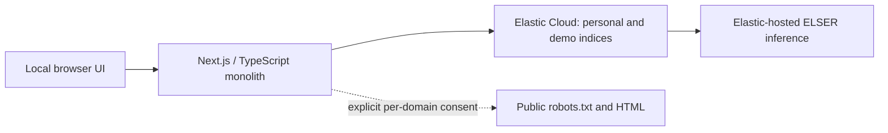

# Architecture

Implements [product requirements](product.md); contracts live in [API](api.md) and
[data model](data-model.md). Privacy constraints override convenience.

## Ownership

- `history`: provider interface, JSON/CSV parsing, canonical validation, URL normalization, merging.
- `elastic`: server-only client, strict mappings, repository, setup/capability probes.
- `search`: deterministic clues, Elasticsearch DSL, evidence and actual-score trace formatting.
- `enrichment`: replaceable public-page enricher, safe transport, robots and readable extraction.
- `workflows`: ephemeral previews, immutable consent tickets, mutation/deletion coordination.
- App Router APIs adapt these modules; React UI consumes typed responses.

`HistoryProvider.parse(text)` returns canonical records, row issues and warnings.
Indexing and retrieval do not know whether records came from JSON, CSV or a future extension.
`PageEnricher.enrich(url, approvedDomains, signal)` returns a fetch status/reason and
optional extracted title/description/plain text/canonical hint, never arbitrary HTML.

## Technology

Next.js App Router, TypeScript, React, Node runtime, official Elastic JS client 9.x,
Zod, csv-parse, Mozilla Readability/jsdom, robots-parser, ipaddr.js, Undici,
Vitest and Playwright. Pin installed versions in package-lock.json. Use local font assets
and lucide icons; no external browser requests for fonts, favicons or analytics.

Target one capability profile: Elastic Cloud Hosted 9.2+ with explicit `.elser-2-elastic`
inference endpoint. Use `match` on `semantic_text`, not the legacy `semantic` query.
Preflight must actually ingest/query synthetic text, run RRF/explain and test partial updates.
No silent change to a third-party model or endpoint. Cloud costs and configuration are user-owned.

## Persistence and Lifecycle

Elasticsearch is the only persistent history store. Two explicit versioned indices isolate
demo and personal data. No SQLite/JSONL/Redis/queue. Previews, approvals, robots cache and
coordination live in bounded process memory and are lost on restart. Import previews expire
after 10 minutes of inactivity; valid commit batches renew this timeout so large imports
can finish. Domain approvals retain a fixed 10-minute expiry (robots cache: 5 minutes).
Files are not written to disk. No browser localStorage history.

Development hot reload retains the in-memory workflow state but refreshes its prototype
to the current implementation. Application errors use a process-stable symbol brand so
safe session/validation errors retain their status and message across module reloads.
A genuinely expired preview must be recreated; committed pages remain and reimport merges
idempotently. Do not silently restore expired consent or reset indexed data during recovery.

One Node process only. One active import preview and one active enrichment preview.
One mutating batch at a time, reject overlaps with 409. Client-driven bounded batches
permit progress/retry without a background worker. Imports: <=25 unique pages/request;
enrichment: <=5 URLs/request. A deletion barrier cancels fetches and waits for writes
before deleting indices. No late writer may recreate history after successful deletion.

## Decisions and Tradeoffs

1. Cloud/EIS chosen by user: local UI does not mean local-only data. Explicit cloud consent.
2. ELSER sparse semantic retrieval plus BM25/native RRF makes Elastic central and inspectable.
3. Date arrays retain all known visits without unnecessary nested per-event documents.
4. Conservative URL identity avoids merging distinct resources or trusting HTML canonicals.
5. No LLM: deterministic clues and indexed quotations remain auditable and cheap.
6. Synchronous bounded work sacrifices unattended import/resume for a much smaller MVP.
7. No authentication means loopback-only operation with Host/Origin protections, not public deployment.

## Review Before Implementation

Reviewed for complexity, gaps, privacy, Elastic value and completion risk on 2026-10-25.
Removed extra storage, queues, connectors and generative explanations. Addressed any-visit
time matching, aggregate-count inflation, per-domain consent, DNS rebinding, deletion races,
cloud processing disclosure, partial failures and uncalibrated confidence.

Remaining external gates: real Cloud credentials, paid capabilities, endpoint region/policies,
live explanation shape, retrieval quality and latency. These cannot be claimed from unit tests.
Source implementation may proceed with offline tests; live acceptance remains blocked until verified.